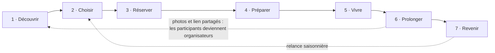

# 2 · Parcours global & fidélisation

> Répond au deuxième point de la restitution : « le parcours global, les fonctionnalités retenues pour le lancement et tes arbitrages ».
> Fil conducteur : **l'organisateur**, la personne qui réserve pour les autres (voir [cadrage](01-cadrage.md)).

## Le parcours, de la découverte à la nouvelle réservation

| Étape | Ce que vit l'organisateur | Point de contact | Ce qu'Échappée y gagne |
|---|---|---|---|
| **1. Découvrir** | Voit une annonce, cherche une sortie, reçoit un lien d'un proche | Campagnes payantes et référencement qui **mènent directement à la fiche activité**, avec paramètres de suivi | Une arrivée mesurable par source de campagne |
| **2. Choisir** | Indique combien ils seront, compare, consulte les créneaux | Site : accueil, fiche activité | Les frictions de choix deviennent visibles |
| **3. Réserver** | Choisit un créneau et le nombre de participants, vérifie le total, paie | Site : récapitulatif, confirmation, ajout à l'agenda | La conversion, et l'email du client (en production) |
| **4. Préparer** (J0 à J-2) | Prévient son groupe, s'organise | Email de confirmation (J0). **Lien à partager avec les participants.** Email de préparation (J-2) : quoi apporter, accès, **météo** | Moins d'absences et de retards ; la marque touche aussi les participants |
| **5. Vivre** (jour J) | Fait l'activité | Sur place : l'animateur prend quelques photos | La matière du message suivant |
| **6. Prolonger** (J+1) | Se souvient de la sortie | Email de remerciement avec les photos et une demande d'avis | Des avis, des photos que l'organisateur partage |
| **7. Revenir** (J+30 et après) | Cherche la prochaine sortie | **Relance saisonnière** selon l'activité faite (kayak l'été → céramique ou escape game l'hiver) ; pour un groupe, rappel **à la même période l'année suivante** | Le réachat à 6 mois, des périodes creuses mieux remplies |

### Comment le produit fait revenir

Les étapes 4 à 7 forment une boucle :
- **L'organisateur** est accompagné avant et après, puis on lui propose la sortie suivante au bon moment de l'année.
- **Les participants** découvrent la marque par le lien partagé et les photos : ce sont les organisateurs de demain.

### La météo (activités en extérieur)

Proposé, à valider avec le client (question Q3 du cadrage) : la prévision figure dans l'email J-2. Si Échappée annule, le client est prévenu par email avec un choix : report, autre activité, ou remboursement selon la politique retenue.

### Ce que le parcours ne couvre pas

Le brief exclut la conception de campagnes d'acquisition. Pour la découverte, on décrit uniquement les **points d'entrée** (une campagne mène à une fiche activité, avec des paramètres de suivi), pas les campagnes.

## Fonctionnalités : construit, proposé, reporté

| ✅ Construit et vérifié (prototype) | 🟡 Proposé pour le lancement (non développé) | ⏭️ Reporté |
|---|---|---|
| Catalogue et filtre « Vous serez combien ? » | Paiement du total en ligne | Compte client |
| Fiche activité, disponibilité écrite en toutes lettres, activité complète consultable | Saisie du prénom et de l'email, consentement séparé pour les relances | Relance des réservations abandonnées |
| Réservation d'un créneau, revérification à la confirmation | Email de confirmation (J0) | Liste d'attente sur un créneau complet |
| Récapitulatif TTC, confirmation, places déduites une seule fois | Email de préparation et météo (J-2) | Rappel par SMS (J-1) |
| Ajout à l'agenda (.ics) | Email de remerciement, avis et photos (J+1) | Carte cadeau |
| **Partage des infos avec le groupe** (partage natif du téléphone, copie sur ordinateur) | Relance saisonnière, rappel annuel pour les groupes | Programme de fidélité, parrainage |
| Frise « Et ensuite ? » montrant les prochains points de contact | Demande de devis au-delà de 10 personnes | Avis affichés sur le site |
| Événements du tunnel (`dataLayer` local, sans outil connecté) | Page d'infos pratiques : météo, annulation, accès | Acompte pour les groupes, annulation en ligne |
| Mention « réservation simulée » sur tout le parcours | Site en anglais | Autres langues |

Le prototype n'envoie aucun email : la frise « Et ensuite ? » décrit ce que ferait la version en ligne, sans jamais dire qu'un message a été envoyé.

## Arbitrages

| # | Choix | Pourquoi |
|---|---|---|
| 1 | **Un seul canal après la réservation : l'email** | Un outil, un consentement. Le SMS coûte plus cher : on l'ajoutera si les absences deviennent un problème mesuré |
| 2 | **Relance saisonnière plutôt que programme de fidélité** | Un programme demande du volume et de la comptabilité. La relance n'utilise que ce qu'on sait déjà (activité, date), remplit les périodes creuses et se mesure par le réachat à 6 mois |
| 3 | **Pas de compte client** | Un compte ajoute de la friction sur mobile ; l'email suffit à reconnaître le client qui revient |
| 4 | **Collecter les avis dès le lancement, les afficher plus tard** | Il faut du volume et de la modération avant de les montrer |
| 5 | **Pas de liste d'attente au lancement** | Elle exige un système de notification. En attendant, un créneau complet renvoie vers les autres créneaux et activités |
| 6 | **Relance des abandons reportée** | Elle suppose d'avoir l'email et le consentement avant la fin du parcours |
| 7 | **Carte cadeau reportée malgré son potentiel** (Noël) | Complexité du paiement et de la comptabilité. Premier candidat pour la V2 |
| 8 | **Partage avec le groupe construit dans le prototype** | Peu coûteux, sans donnée collectée, et il rend concret le rôle de l'organisateur |
