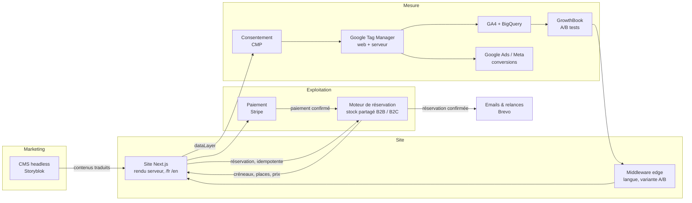

# 5 · Recommandation technique

> Répond au troisième point de la restitution : « l'approche technique proposée pour le site, le CMS headless, le multilingue, l'analytics et les futurs A/B tests. Présente les solutions envisagées, leurs rôles et les compromis, en distinguant la cible de production du prototype ».

## Principe directeur

**Chaque brique a un seul rôle, et une seule source de vérité.**
- Le **contenu** (textes, images, traductions, pages de campagne) appartient au marketing : il vit dans le **CMS**.
- Les **places et les prix** appartiennent à l'exploitation et sont partagés avec le B2B (hypothèse H1) : ils vivent dans le **moteur de réservation**, jamais dans le CMS ni dans le site.
- Le **site** assemble les deux, et pousse des événements de mesure **uniques**, utilisés à la fois par l'analytics et par les A/B tests.

Le prototype applique déjà cette séparation : `activities.json` (futur CMS) est distinct de `slots.json` (futur moteur de réservation), et les règles métier vivent dans `src/domain`, indépendantes de l'interface.

## Architecture cible

## Les briques, une par une

### Le site · Next.js

| | |
|---|---|
| **Rôle** | Afficher l'offre, porter le parcours de réservation, rendre les pages vite sur mobile et lisibles par les moteurs de recherche |
| **Recommandation** | **Next.js** (React), rendu serveur et pages statiques régénérées à la publication d'un contenu, hébergé sur Vercel |
| **Envisagé** | Astro : excellent pour un site de contenu, moins adapté à un parcours de réservation interactif. Un CMS « tout-en-un » (Webflow, WordPress) : rapide à lancer, mais limité pour le tunnel, la mesure fine et les A/B tests côté serveur |
| **Pourquoi** | Référencement et vitesse mobile (rendu serveur), routage par langue intégré, middleware edge pour les A/B tests sans clignotement. Le prototype est en React : composants et logique métier se réutilisent |
| **Compromis** | Plus d'ingénierie qu'un outil sans code ; dépendance à l'hébergeur atténuée (Next.js s'héberge ailleurs) |

### Le CMS headless · Storyblok

| | |
|---|---|
| **Rôle** | Rendre le marketing autonome : fiches activités, pages de campagne, FAQ, infos pratiques, traductions, images |
| **Recommandation** | **Storyblok** |
| **Envisagé** | Contentful (robuste, plus cher, édition moins visuelle), Strapi (open source, mais hébergement et maintenance à la charge d'Échappée), Sanity (très souple, plus orienté développeurs) |
| **Pourquoi** | Le critère du brief est « gérer les contenus **sans dépendre systématiquement d'un développeur** ». L'éditeur visuel de Storyblok permet de composer une page de campagne à partir de blocs prêts à l'emploi, avec aperçu avant publication. Traduction champ par champ intégrée |
| **Ce qui n'y va pas** | Les créneaux, les places et les prix : ils viennent du moteur de réservation. Sinon, deux sources de vérité et un risque de prix ou de disponibilité faux |
| **Compromis** | Coût par utilisateur ; un modèle de contenu (blocs) à concevoir au départ, sinon l'autonomie promise n'existe pas |

### Le moteur de réservation · à décider avec le client

| | |
|---|---|
| **Rôle** | Seule source de vérité des créneaux et des places, partagée avec le B2B ; prise de réservation fiable |
| **Recommandation** | Dépend de la question Q1 du cadrage (« dans quel outil vivent les places aujourd'hui ? »). Si l'outil actuel a une API : on s'y branche. Sinon, une solution de réservation pour activités de loisirs avec API, plutôt qu'un développement sur mesure |
| **Exigences, quelle que soit la solution** | Décompte **atomique** des places ; **clé d'idempotence** à la confirmation (l'équivalent du `draftId` du prototype) ; **blocage temporaire des places** pendant le paiement (10 minutes environ) pour éviter de vendre deux fois la dernière place ; revérification serveur de toutes les règles (le site ne fait que guider) |
| **Paiement** | **Stripe** : paiement du total en ligne (H4). La réservation n'est confirmée qu'à la réception de la confirmation de paiement |

### Le multilingue · FR et EN au lancement

| | |
|---|---|
| **URLs** | Une URL par langue (`/fr/activites/kayak-calanques`, `/en/activities/sea-kayaking`), balises `hreflang`. Chaque langue est référencée séparément |
| **Contenus** | Traduits dans Storyblok, champ par champ. Un contenu non traduit n'est pas publié dans cette langue |
| **Textes d'interface** | Fichiers de traduction dans le code (`next-intl`) : boutons, messages d'erreur, libellés |
| **Formats** | Dates, heures et prix via l'API `Intl` du navigateur selon la langue. Le prototype l'utilise déjà (`src/lib/format.ts`, locale centralisée) |
| **Détection** | Proposer la langue du navigateur, **ne jamais rediriger d'office** (mauvais pour le référencement et frustrant) |
| **Compromis** | Coût et délai de traduction à chaque contenu : traduction automatique relue, pour tenir le rythme du marketing |

### L'analytics · GA4 via Google Tag Manager, avec consentement

| | |
|---|---|
| **Rôle** | Comprendre le parcours (tunnel, frictions) et piloter les campagnes payantes du lancement |
| **Recommandation** | **Google Tag Manager** (côté navigateur et côté serveur) alimenté par le `dataLayer`, **GA4** pour les parcours, **export BigQuery** pour les analyses fines (réachat, cohortes), **conversions envoyées côté serveur** à Google Ads et Meta. Une **CMP** (bandeau de consentement) avec le mode consentement de Google |
| **Envisagé** | Matomo (respect de la vie privée, mesure d'audience exemptable de consentement sous conditions CNIL) ; PostHog ou Amplitude (analyse produit plus fine). Ni l'un ni l'autre ne se connecte aussi directement aux régies publicitaires |
| **Pourquoi** | Le brief cite explicitement le **pilotage des campagnes payantes**. GA4 et GTM sont les plus directement reliés à Google Ads et Meta. Le suivi côté serveur réduit les pertes liées aux bloqueurs et aux navigateurs |
| **Ce que le prototype prépare** | Les événements du tunnel sont déjà poussés dans `window.dataLayer`, avec les noms du plan de mesure (`view_item`, `select_slot`, `begin_checkout`, `view_summary`, `booking_confirmed`, `booking_error`) |
| **Compromis** | Sans consentement, une partie des sessions n'est pas mesurée : les taux du tunnel sont calculés sur les sessions consenties. La conversion, elle, est confirmée par le moteur de réservation (source exacte). Voir les limites au [plan de mesure](06-mesure.md) |

### Les futurs A/B tests · une stack prête, pas d'expérience au lancement

| | |
|---|---|
| **Rôle** | Pouvoir tester une variante (ex. ordre des infos sur la fiche, libellé du bouton) et mesurer son effet sur le tunnel |
| **Recommandation** | **GrowthBook** (open source) : affectation de la variante **côté serveur, dans le middleware edge** de Next.js, donc sans clignotement ni ralentissement. Les variantes de contenu peuvent être préparées dans Storyblok par le marketing |
| **Envisagé** | Optimizely, VWO, AB Tasty : complets mais coûteux, souvent côté navigateur (clignotement, poids de page). Statsig : proche de GrowthBook, non open source |
| **Pourquoi c'est compatible** | Les mêmes événements que l'analytics servent de métriques ; un événement d'exposition (`experiment_viewed`) part dans le `dataLayer` ; GrowthBook lit les résultats dans BigQuery |
| **Prérequis** | Identifiant visiteur stable (après consentement), métriques définies à l'avance |
| **Compromis** | **Au lancement, le trafic sera trop faible** pour conclure vite. Les premières semaines servent à établir la référence (hypothèse H10) ; les premiers tests visent les étapes à fort volume (fiche activité) |

### Les emails et relances · Brevo

| | |
|---|---|
| **Rôle** | Points de contact hors site du parcours : confirmation (J0), préparation (J-2), merci et avis (J+1), relance saisonnière |
| **Recommandation** | **Brevo** : emails transactionnels et automatisations dans un même outil, hébergement européen |
| **Compromis** | Un outil de plus à connecter au moteur de réservation (événement « réservation confirmée ») ; les relances exigent un consentement séparé |

## Prototype et cible de production

| Brique | Prototype (construit) | Cible de production (proposé) |
|---|---|---|
| Site | Vite + React, application d'une page, URLs avec `#` | Next.js, rendu serveur, URLs par langue |
| Contenu | `src/data/activities.json` | Storyblok |
| Créneaux et places | `src/data/slots.json` + `sessionStorage` | Moteur de réservation (API), stock partagé B2B |
| Règles métier | `src/domain`, testées (63 tests) | Même logique, appliquée **côté serveur** ; le site ne fait que guider |
| Décompte unique | `draftId` (confirmation idempotente) | Clé d'idempotence + transaction en base + blocage temporaire des places |
| Paiement | Aucun (simulé) | Stripe |
| Langues | Français, formats `Intl` centralisés | FR + EN, `next-intl`, traductions dans Storyblok |
| Analytics | `window.dataLayer` + console, aucun outil | CMP + GTM (web et serveur) + GA4 + BigQuery + conversions publicitaires |
| A/B tests | Aucun | GrowthBook dans le middleware edge |
| Emails | Aucun (frise « Et ensuite ? ») | Brevo |

## Conformité au brief

| Demande du brief | Réponse |
|---|---|
| « Un CMS headless pour que les équipes marketing puissent gérer les contenus sans dépendre systématiquement d'un développeur » | Storyblok, éditeur visuel, blocs, traduction ; ce qui n'y va pas (places, prix) |
| « Une solution analytics pour comprendre le parcours de réservation et piloter les campagnes marketing payantes » | GTM + GA4 + BigQuery, conversions côté serveur vers Google Ads et Meta, CMP |
| « Un site multilingue » | URLs par langue, `hreflang`, traductions CMS et interface, formats `Intl` |
| « Une stack technologique compatible pour de futurs A/B tests » | Next.js + middleware edge + GrowthBook, mêmes événements que l'analytics |
| « Présente les solutions envisagées, leurs rôles et les compromis » | Pour chaque brique : rôle, recommandation, alternatives, compromis |
| « En distinguant la cible de production du prototype » | Tableau prototype / production |
| « Leur intégration complète n'est pas attendue dans le prototype » | Rien n'est branché ; le prototype prépare la séparation contenu / places et le `dataLayer` |
